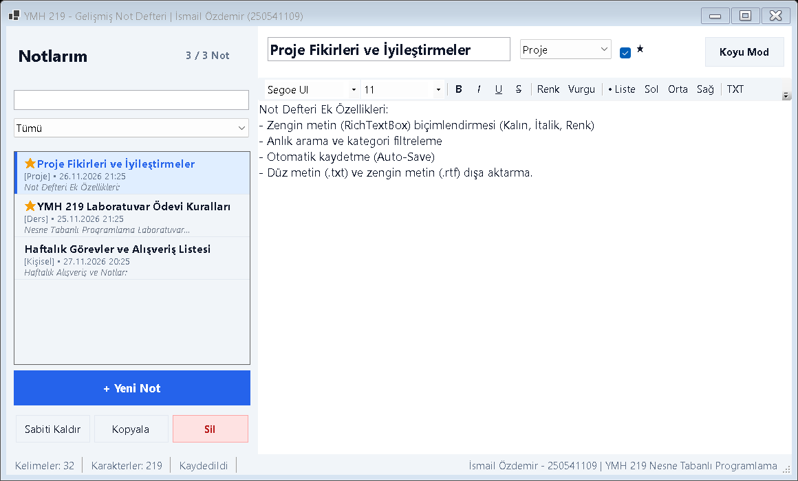
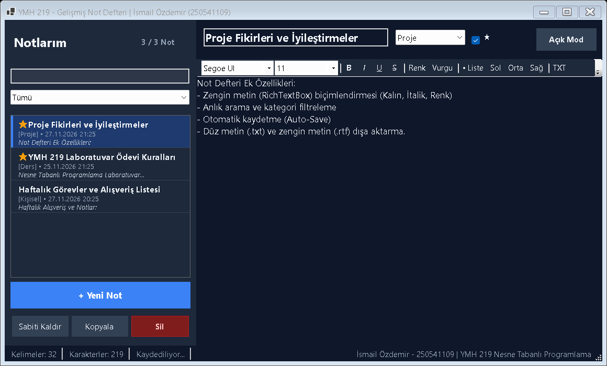

# YMH219 - Gelişmiş Not Defteri Uygulaması (NotepadApp)
> **Kocaeli Üniversitesi — Bilgisayar / Yazılım Mühendisliği**  
> **Ders:** YMH 219 - Nesne Tabanlı Programlama  
> **Ödev:** 6. Ek Uygulama Ödevi — Not Defteri Uygulaması (Dosya İşlemleri + Serileştirme)  
> **Öğrenci Adı Soyadı:** İsmail Özdemir  
> **Öğrenci Numarası:** 250541109  
> **GitHub Deposu:** [ismailozdemir27/YMH219-NotepadApp](https://github.com/ismailozdemir27/YMH219-NotepadApp)  
> **Son Teslim Tarihi:** 29.11.2026  

---

## 1. Proje Amacı ve Genel Bakış

Bu proje; nesne tabanlı programlama prensipleri, modern C# ve .NET 8.0 teknolojileri ile geliştirilmiş, kullanıcı notlarını güvenli biçimde saklayan ve zengin metin düzenleme yeteneklerine sahip masaüstü bir **Not Defteri** uygulamasıdır.

Uygulamanın odak noktası; verinin yerel dosya sistemine yazılıp okunması (**File I/O**), nesne modellerinin kalıcı hâle getirilmesi (**JSON Serialization / Deserialization**) ve beklenmedik sistem kesintilerine karşı veri bütünlüğünün korunmasıdır. Uygulama kapatılıp açılsa bile kullanıcının tüm notları, biçimlendirmeleri ve kategori yapılandırmaları eksiksiz korunur.

---

## 2. Ekran Görüntüleri

### Açık Mod (Light Mode)


### Koyu Mod (Dark Mode)


---

## 3. Kullanılan Teknolojiler ve Kütüphaneler

| Teknoloji / Kütüphane | Sürüm | Kullanım Alanı ve Açıklama |
| :--- | :--- | :--- |
| **C# / .NET** | 8.0 (net8.0-windows) | Temel programlama dili ve modern çalışma zamanı ortamı |
| **Windows Forms (WinForms)** | .NET 8.0 | Masaüstü grafik kullanıcı arayüzü (GUI) ve olay güdümlü mimari |
| **System.Text.Json** | Dahili | Yüksek performanslı UTF-8 JSON serileştirme ve ayrıştırma |
| **System.IO** | Dahili | `File`, `StreamWriter`, `StreamReader`, `Path` ile dosya işlemleri |
| **GDI+ (System.Drawing)** | Dahili | Özel liste kartı çizimi (`OwnerDraw`), dinamik renk paletleri ve tema motoru |

*Not: Uygulama harici üçüncü parti bağımlılığa ihtiyaç duymadan, modern .NET 8 SDK'nın optimize edilmiş yerel kütüphaneleriyle çalışmaktadır.*

---

## 4. Uygulama Mimarisi ve Ders Kavramları

Uygulama, nesne tabanlı tasarım ve katmanlı mimari ilkelerine göre kurgulanmıştır:

```
YMH219-NotepadApp/
├── Models/
│   ├── Note.cs                # Tekil not modeli (Id, Title, Content, Rtf, Category, IsPinned, vb.)
│   └── NoteCategory.cs        # Kategori sabitleri ve filtreleme listeleri
├── Services/
│   └── NoteStorageService.cs  # Atomik JSON kaydetme, yedekten kurtarma, TXT/RTF export/import
├── Forms/
│   ├── MainForm.cs            # Olay yönetimi, debounced auto-save, tema motoru, arama ve filtreleme
│   └── MainForm.Designer.cs   # Dinamik TableLayoutPanel, RichTextBox, ToolStrip ve liste düzeni
├── screenshots/               # Ekran görüntüleri (main_light.png, main_dark.png)
├── Program.cs                 # Giriş noktası ve otomatik ekran görüntüsü üretim CLI desteği
└── NotepadApp.csproj          # .NET 8 proje yapılandırma dosyası
```

### Öne Çıkan Tasarım Prensipleri:
1. **Model-Servis Ayrımı (Separation of Concerns):**  
   Veri saklama, serileştirme ve dosya işlemleri UI formundan tamamen izole edilerek `NoteStorageService` sınıfında toplanmıştır.
2. **Atomik Dosya Yazma (Atomic File I/O):**  
   Kayıt sırasında doğrudan asıl dosya üzerine yazmak yerine önce `.tmp` uzantılı geçici dosyaya yazılır, mevcut dosya `notes_backup.json` olarak yedeklenir ve atomik dosya taşıma (`File.Move`) ile veri kaybı riski ortadan kaldırılır.
3. **Hata Yönetimi ve Kurtarma (Resilience & Error Handling):**  
   Asıl dosya bulunamadığında veya bozulduğunda otomatik olarak yedek dosyaya başvurulur; her iki dosya da yoksa örnek başlangıç verileri üretilerek programın çökmesi engellenir.
4. **Zaman Damgası Yönetimi:**  
   Her notun oluşturulma (`CreatedAt`) ve son düzenlenme (`UpdatedAt`) tarihleri milisaniye hassasiyetinde tutulur ve arayüzde biçimlendirilmiş olarak gösterilir.

---

## 5. Uygulamanın Özellikleri

### A. Asgari Uygulama Gereksinimleri (Föy Kapsamı)
- [x] **CRUD İşlemleri:** Başlık ve içerikten oluşan not ekleme, listeleme, anlık düzenleme ve onaylı silme.
- [x] **JSON Serileştirme:** Tüm notların `List<Note>` koleksiyonu olarak JSON dosyasına kaydedilmesi ve uygulama açılışında otomatik geri yüklenmesi.
- [x] **Düz Metin (.txt) Dışa Aktarma:** `StreamWriter` kullanılarak not başlığı, kategorisi, tarihçesi, öğrenci bilgisi ve içeriği ile biçimli `.txt` dosyası üretimi.
- [x] **Sağlam Hata Yönetimi:** Dosya bulunamaması, okuma/yazma izin hataları ve bozuk dosya senaryolarına karşı `try-catch` blokları ve loglama.

### B. İsteğe Bağlı Geliştirmeler (Bonus Özellikler - Tam Puan)
- [x] **Anlık Arama ve Filtreleme:** Arama kutusuna yazıldığı anda not başlıkları ve içeriklerinde büyük/küçük harf duyarsız canlı filtreleme.
- [x] **Otomatik Kaydetme (Debounced Auto-Save):** Kullanıcı yazı yazarken arayüzü kilitlemeyen 600 ms debounced zamanlayıcı ile değişikliklerin anında JSON dosyasına aktarılması.
- [x] **Kategori ve Etiket Desteği:** Notları kategorilere ayırma (`Ders`, `Proje`, `Kişisel`, `Önemli`, `Genel`) ve kategoriye göre süzebilme.
- [x] **Zengin Metin (RichTextBox) Biçimlendirmesi:** 
  - Yazı tipi ailesi ve boyutu seçimi
  - **Kalın (Bold)**, *İtalik (Italic)*, <u>Altı Çizili (Underline)</u>, ~~Üstü Çizili (Strikethrough)~~
  - Metin rengi ve metin vurgu rengi paleti seçici
  - Madde işaretli liste (Bullet list) oluşturma
  - Sola, ortaya ve sağa hizalama
  - Zengin metin biçimini `.rtf` olarak kaydetme ve içe aktarma desteği

### C. Ekstra Kullanılabilirlik İyileştirmeleri
- [x] **Sabitlenen Notlar (★ Pinned):** Önemli notları listenin en başına sabitleme desteği.
- [x] **Hızlı Not Kopyalama (Duplicate):** Tek tıkla mevcut notun kopyasını oluşturabilme.
- [x] **Açık / Koyu Tema (Dark Mode):** Göz yormayan modern karanlık tema ile klasik açık tema arasında tek tıkla geçiş.
- [x] **Canlı Kelime ve Karakter Sayacı:** Not düzenlenirken anlık olarak kelime ve karakter sayısının alt durum çubuğunda raporlanması.
- [x] **Gelişmiş Kart Görünümü (OwnerDraw):** Listede her not için başlık, kategori etiketi, tarih ve ilk satır önizlemesini içeren özel GDI+ çizimi.

---

## 6. Kurulum ve Çalıştırma Adımları

### Gereksinimler:
- Windows 10 / 11 (x64)
- [.NET 8.0 SDK](https://dotnet.microsoft.com/download/dotnet/8.0) (Kaynak koddan derlemek için)

### Adım 1: Depoyu Klonlayın
```bash
git clone https://github.com/ismailozdemir27/YMH219-NotepadApp.git
cd YMH219-NotepadApp
```

### Adım 2: Projeyi Derleyin
```bash
dotnet build
```

### Adım 3: Uygulamayı Çalıştırın
```bash
dotnet run
```

### Alternatif: Visual Studio ile Çalıştırma
1. `NotepadApp.csproj` dosyasını Visual Studio ile açın.
2. Hedef profili `Release` veya `Debug` olarak seçin.
3. `F5` tuşuna basarak projeyi başlatın.

### Otomatik Ekran Görüntüsü Üretimi (CLI):
```bash
dotnet run -- --generate-screenshots
```

---

## 7. Bilinen Sınırlamalar ve Gelecek Geliştirme Notları

- **Platform Sınırlaması:** Uygulama Windows Forms altyapısı üzerine inşa edildiği için Windows işletim sistemine özgüdür (Linux / macOS için MAUI veya Avalonia UI mimarisine taşınabilir).
- **Zengin Metin Standardı:** RTF biçimlendirmeleri Windows RichEdit kontrolleri üzerinden yönetilmektedir. Çok karmaşık tablolar veya gömülü nesneler düz metin dışa aktarımında sadeleştirilir.
- **Gelecek İyileştirmeler:**
  - Notlar için AES-256 şifreleme ve parola koruması eklenmesi.
  - Not içeriklerine resim ve ek dosya iliştirme desteği.
  - Bulut senkronizasyonu (Google Drive / GitHub Gist entegrasyonu).

---

## 8. Değerlendirme Ölçütleri ve Teslim Kontrol Listesi

| Ölçüt | Föy Puanı | Proje Durumu |
| :--- | :---: | :--- |
| **Uygulamanın çalışması ve temel işlevlerin eksiksizliği** | 40 | CRUD, JSON serileştirme, TXT dışa aktarma, kalıcılık eksiksiz |
| **Nesne tabanlı tasarım, kod düzeni ve hata kontrolleri** | 20 | Katmanlı mimari, model-servis ayrımı, atomik dosya yazımı |
| **Kullanıcı etkileşimi ve geri bildirim** | 10 | Canlı arama, sayaçlar, debounced auto-save, dark/light tema |
| **Git/GitHub düzeni, anlamlı commit geçmişi ve .gitignore** | 15 | Düzenli commit geçmişi, temiz `.gitignore`, gereksiz dosyalar hariç |
| **README.md, ekran görüntüleri ve çalıştırma açıklaması** | 10 | Detaylı dokümantasyon ve güncel 2 adet ekran görüntüsü |
| **Kodun açıklanabilmesi / kısa sözlü kontrol** | 5 | Açıklayıcı XML dokümantasyon yorumları ve temiz kodlama standardı |
| **TOPLAM** | **100** | **Tam Uyumluluk (Tüm isteğe bağlı geliştirmeler dahil)** |

---

## 9. Öğrenci ve Proje Bilgileri

- **Öğrenci Adı Soyadı:** İsmail Özdemir  
- **Öğrenci Numarası:** 250541109  
- **Üniversite:** Kocaeli Üniversitesi  
- **Fakülte / Bölüm:** Bilişim Fakültesi / Yazılım Mühendisliği  
- **Ders:** YMH 219 — Nesne Tabanlı Programlama  
- **Teslim Platformu:** GitHub + Google Classroom  
- **Depo Adı:** `YMH219-NotepadApp`  
